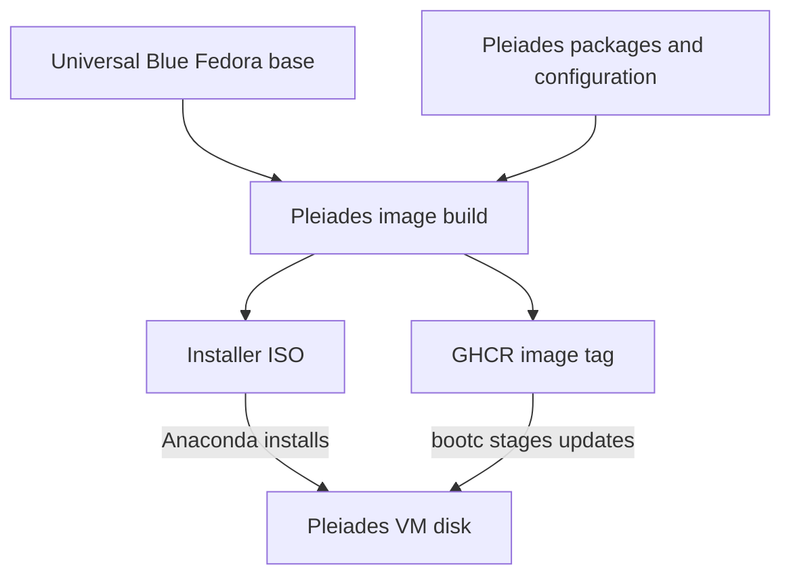

# Pleiades

The Pleiades, also known as the Seven Sisters or Messier 45 (M45), is a young open star cluster in the constellation Taurus. Its brightest members are hot, blue stars that form a tight grouping visible to the unaided eye.

  <picture>
    <source media="(prefers-color-scheme: dark)" srcset="./doc/img/pleiades_logo_dark.png">
    
  </picture>

Pleiades is a Fedora-based Linux workstation built around the Sway Wayland compositor. It ships a configured desktop, command-line development tools, and support for Flatpak and Incus.

## The Pleiades bootc image

Pleiades distributes its operating system as a bootable container image. The image contains the Linux kernel, system tools, desktop packages, and default configuration. Once installed, Pleiades boots from disk as the machine’s operating system, with its own kernel and systemd. The `bootc` tool pulls updated images from a container registry and stages them for the next reboot. It can also select the previous OS deployment for rollback.

## How the image is built

The [`Containerfile`](./Containerfile) starts from Universal Blue’s Fedora-based `ghcr.io/ublue-os/base-main:latest` image. It copies the defaults from [`system_files/`](./system_files/), runs the scripts in [`build_files/`](./build_files/) to install packages and enable services, and checks the result with `bootc container lint`.

[GitHub Actions](./.github/workflows/build.yml) builds the image with Buildah and publishes it to [GitHub Container Registry](https://github.com/NMD03/pleiades/pkgs/container/pleiades). For a fresh installation, `bootc-image-builder` packages the image into an ISO with the Anaconda installer. Once installed, the system gets updates directly from its configured registry tag.

## Documentation

- [Desktop environment](./doc/desktop.md)
- [External monitors and shortcuts](./doc/monitors.md)
- [First boot setup](./doc/first_boot.md)
